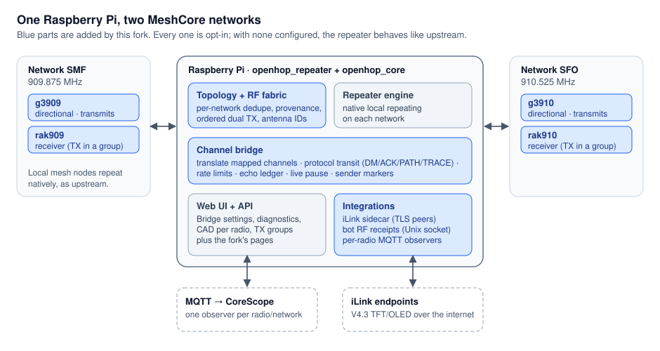
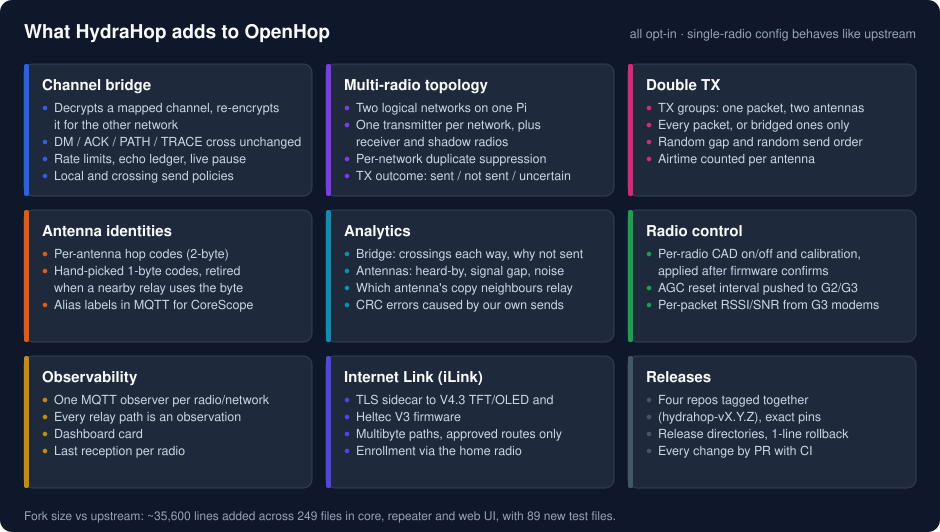
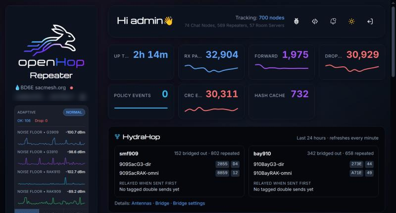
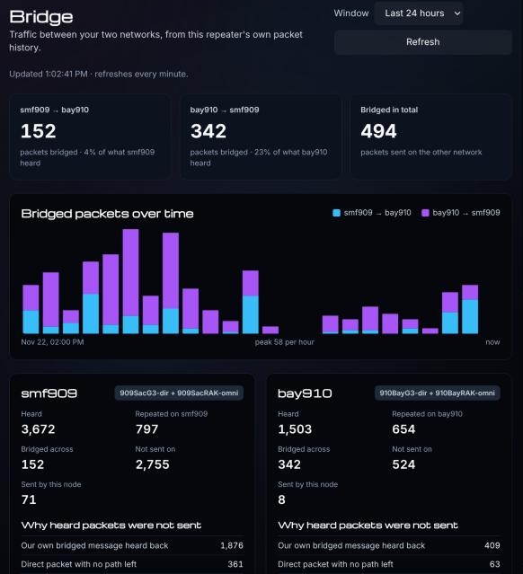
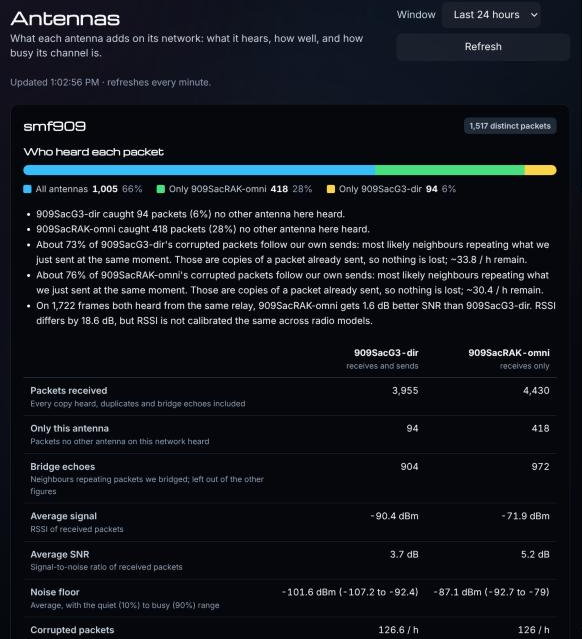
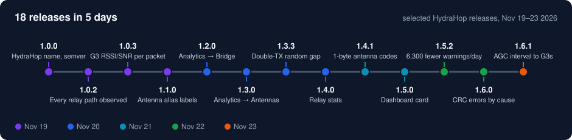

# HydraHop

**Kesh's fork of [OpenHop](https://github.com/openhop-dev): one Raspberry Pi, several radios, two MeshCore networks.**

   

HydraHop runs one OpenHop repeater across the Sacramento (909.875 MHz) and Bay (910.525 MHz) meshes. Each network keeps native local repeating. On top of that, HydraHop translates selected channels between the networks, sends through more than one antenna, tells antennas apart in relayed paths, and shows what happened on its own analytics pages.

| | |
|---|---|
| **Current release** | **HydraHop 1.8.0** (`hydrahop-v1.8.0`, 2026-11-24). Core, repeater, web UI and this hub are tagged together. [Changelog](CHANGELOG.md) · [Pins](components.current.json) |
| **Run it** | [Upgrade a Pi](docs/upgrade.md) (new release directory, one-line rollback) · [Build and test](docs/build-and-test.md) · No fresh-install guide yet: [open an issue](https://github.com/kesh33w/hydrahop/issues) and I'll help |
| **Feature reference** | [Repeater](https://github.com/kesh33w/openhop_repeater/blob/kesh/bridge/docs/fork/README.md) (every config key and default) · [Core](https://github.com/kesh33w/openhop_core/blob/kesh/bridge/README.md#what-this-fork-changes) · [Web UI](https://github.com/kesh33w/openHop_RepeaterUI/blob/kesh/bridge/README.md#what-this-fork-adds) · [Web API](https://github.com/kesh33w/openhop_repeater/blob/kesh/bridge/docs/fork/bridge-api.md) |
| **Feedback** | Questions and bugs for all four repositories go to [this hub's issues](https://github.com/kesh33w/hydrahop/issues). Security: [SECURITY.md](SECURITY.md) |

## What HydraHop adds to OpenHop

Every addition is opt-in. With none of HydraHop's configuration present, a single-radio node behaves like upstream OpenHop.

| Area | Feature | What it does | Since |
|---|---|---|---|
| **Bridge** | [Channel translation](https://github.com/kesh33w/openhop_repeater/blob/kesh/bridge/docs/fork/README.md#channel-translation) | Decrypts an authorised channel on one network and re-encrypts it for a mapped channel on the other | pre-1.0 |
| | [Protocol transit](https://github.com/kesh33w/openhop_repeater/blob/kesh/bridge/docs/bridge-protocol-routing.md) | DMs, ACKs, path discovery, repeater admin and TRACE cross on explicit routes, still encrypted | pre-1.0 |
| | [Safeguards](https://github.com/kesh33w/openhop_repeater/blob/kesh/bridge/docs/fork/README.md#bridge-safeguards-and-live-pause) | Per-direction rate limits, bounded queues, a restart-safe echo ledger and a live **Pause crossings** switch | pre-1.0 |
| | [Send policies](https://github.com/kesh33w/openhop_repeater/blob/kesh/bridge/docs/fork/README.md#per-send-policies) | Separate rules for local repeats and crossings, e.g. a bridge-only network | pre-1.0 |
| **Radios** | [Network topology](https://github.com/kesh33w/openhop_repeater/blob/kesh/bridge/docs/logical-receivers.md) | Two logical networks, one transmitter each, plus receiver and shadow radios merged into one reception | pre-1.0 |
| | [Double TX](https://github.com/kesh33w/openhop_repeater/blob/kesh/bridge/docs/ordered-dual-tx.md) | One packet sent through two antennas in turn, for every packet or bridged ones only; random gap (1.3.3) and order (1.4.0) | pre-1.0 |
| | [Antenna identities](https://github.com/kesh33w/openhop_repeater/blob/kesh/bridge/docs/tx-identities.md) | Our hop in a relayed path names the antenna that heard or sent it; hand-picked 1-byte codes (1.4.1) retire themselves when a relay within 2 hops uses the byte | pre-1.0 |
| | [CAD per radio](https://github.com/kesh33w/openhop_repeater/blob/kesh/bridge/docs/per-radio-cad.md) | Channel-activity detection on/off and calibration per radio, applied once firmware confirms | pre-1.0 |
| | [AGC reset](https://github.com/kesh33w/openhop_repeater/blob/kesh/bridge/docs/fork/README.md#radio-control) | `agc.reset.interval` applied over the modem link (firmware v1.4.2+), or pushed over HTTP to older G2/G3s | 1.6.1, 1.7.0, 1.8.0 |
| **Analytics** | Bridge page | Packets bridged each way, local repeats, why heard packets were not sent, sends per antenna pair | 1.2.0 |
| | Antennas page | Which antennas heard each packet, signal gap, noise floor, CRC errors, repeaters heard, channel-busy waits | 1.3.0 |
| | Relay attribution | Which antenna's copy neighbours relayed, split by send order | 1.4.0 |
| | CRC by cause | Corrupted packets that follow our own sends versus other causes | 1.6.0 |
| | Dashboard card | Per-network bridged and repeated counts, antenna codes, Internet Link peers | 1.5.0 |
| **Observability** | [Per-radio MQTT observers](https://github.com/kesh33w/openhop_repeater/blob/kesh/bridge/docs/separate-observer-identities.md) | One observer per radio and network on CoreScope; every relay path is its own observation (1.0.2) with RSSI/SNR (1.0.3) and antenna labels (1.1.0) | pre-1.0 |
| **Links** | [Internet Link (iLink)](docs/ilink.md) | TLS sidecar that connects the Pi to Heltec V4.3 TFT/OLED and V3 firmware for multibyte traffic | pre-1.0 |
| **Reliability** | [Transmit outcomes](https://github.com/kesh33w/openhop_core/blob/kesh/bridge/README.md#what-this-fork-changes) | Every send ends as confirmed, not sent (safe to retry) or uncertain (never retried); USB modem I/O on its own threads | pre-1.0 |

**Fork size:** about 35,600 lines added across 249 files in core, repeater and web UI since their upstream bases, with 89 new test files.

## Screenshots

From the live Pi (node key blurred).

<table>
<tr>
<td width="50%"></td>
<td width="50%"></td>
</tr>
<tr>
<td align="center"><b>Analytics → Bridge</b>: what crossed each way, and why the rest didn't</td>
<td align="center"><b>Analytics → Antennas</b>: what each antenna adds on its network</td>
</tr>
</table>

## Release history

Semantic versions (`hydrahop-vX.Y.Z`) are tagged in all four repositories at once: PATCH for fixes, MINOR for features, MAJOR for changes that need manual steps. Full notes: [CHANGELOG.md](CHANGELOG.md). Older date tags (`kesh-YYYY.MM.DD`) remain as history.

## How the bridge works

- **Native routing runs first.** Each network repeats its own traffic as upstream does. The bridge only adds a separate crossing copy where a mapping and the crossing policy allow it.
- **Mappings are directional.** Add the reverse mapping for replies. Only ordinary group text in flood packets is translated; signed group subtypes, DMs and control traffic never take this path.
- **Direct messages and ACKs** cross on separately enabled explicit-path routes without being decrypted. Flooded DMs and unknown reverse paths do not cross.
- **Local and crossing sends are independent.** Dropping one never cancels the other. Each goes through the normal radio queues and airtime accounting.
- **Channel keys are write-only**: the settings API never returns them. Echo suppression survives restarts.

> [!IMPORTANT]
> The bridge needs authorised keys for both channels and is a trusted plaintext boundary. Translation is not end-to-end encryption across distinct channel keys, and channel authentication does not prove which member sent a message.

## Repositories

| Repository | Branch | Role |
|---|---|---|
| **hydrahop** (this hub) | `kesh/openhop-bridge` | Release pins, upgrade guide, iLink sidecar, enrollment, integration tests, firmware releases |
| [openhop_repeater](https://github.com/kesh33w/openhop_repeater) | `kesh/bridge` | The repeater daemon: bridge, topology, analytics APIs, built web UI |
| [openhop_core](https://github.com/kesh33w/openhop_core) | `kesh/bridge` | MeshCore protocol library: multi-radio fabric, TX groups, radio drivers |
| [openHop_RepeaterUI](https://github.com/kesh33w/openHop_RepeaterUI) | `kesh/bridge` | Web dashboard source |
| [openhop_modem](https://github.com/kesh33w/openhop_modem/tree/kesh/heltec-bench) | `kesh/heltec-bench` | USB bench modem targets (Heltec T096, V4.3) |
| [MeshCore iLink firmware](https://github.com/kesh33w/MeshCore/tree/kesh/v43-tft-ilink) | `kesh/v43-tft-ilink`, [`v43-oled-ilink`](https://github.com/kesh33w/MeshCore/tree/kesh/v43-oled-ilink), [`v3-oled-ilink`](https://github.com/kesh33w/MeshCore/tree/kesh/v3-oled-ilink) | iLink endpoints: [firmware releases and verification](docs/firmware.md) |

[components.current.json](components.current.json) pins **HydraHop 1.8.0**: core `57022d8`, repeater `b22ff2d` and web UI `96177d5`. The [upgrade guide](docs/upgrade.md) installs exactly these commits. [components.json](components.json) and the release manifests keep the original published pins; see [branch history](docs/branch-history.md). Runtime keys, certificates, Wi-Fi passwords, live routes and enrollment records are installation inputs and are never committed.

Predecessors `openhop-channel-bridge`, `openhop-bridge` and `meshcore-bridge` are archived and read-only. Contributing: see the repeater's [CONTRIBUTING.md](https://github.com/kesh33w/openhop_repeater/blob/kesh/bridge/CONTRIBUTING.md), which covers all four repositories.

## Credits and hosting

Kesh uses the sacmesh.org domain for this project. The [SACMesh website](https://sacmesh.org/firmware/) is managed separately. See [credits and licenses](NOTICE.md) for the OpenHop, MeshCore and third-party acknowledgements.
